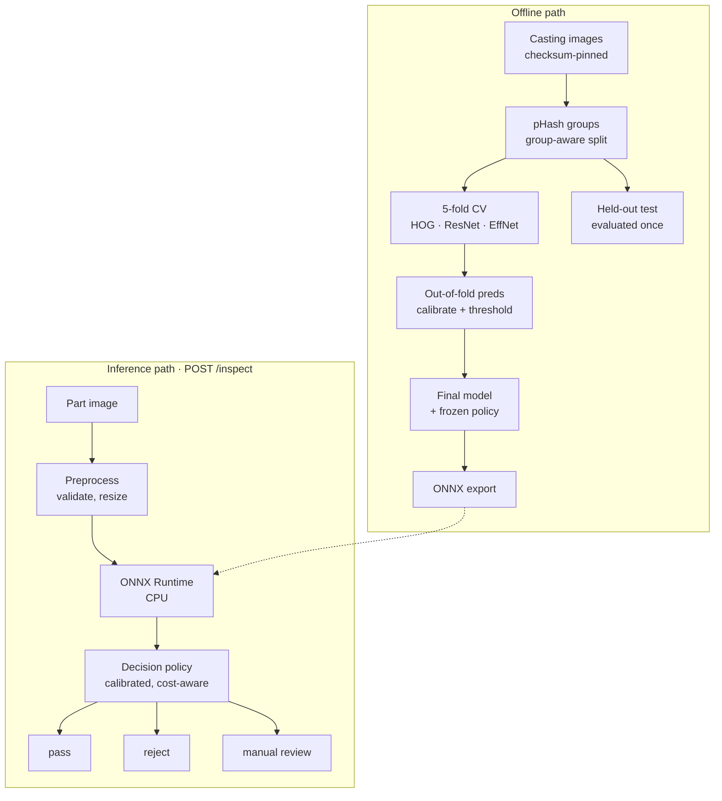

# Architecture

Two paths share one codebase: an offline path that cleans and groups the data, measures
three model tiers with cross-validation and freezes a cost-aware operating point on
out-of-fold predictions, and an inference path that serves the ONNX model with a three-way
pass / reject / manual-review decision.

Preprocessing and the decision policy are shared modules: the API, the evaluation harness
and the ONNX parity tests call exactly the same code.

## Offline path

1. **Data** (`data/`): checksum-pinned acquisition, per-file integrity checks, 64-bit dHash
   grouping of near-duplicates, and a group-aware stratified split (20% test, 5 folds) with
   a zero-leakage guarantee.
2. **Models** (`models/`): three tiers behind one protocol — HOG + logistic regression, a
   frozen ResNet-18 linear probe, and a fine-tuned EfficientNet-B0.
3. **Evaluation** (`evaluation/`): grouped cross-validation producing out-of-fold
   predictions, metrics with exact Clopper-Pearson intervals and grouped-bootstrap AUROC.
4. **Decision** (`decision/`): temperature calibration, a recall-targeted reject threshold
   and a cost-aware review band, frozen to `configs/policy.yaml`.

## Inference path

The final model is exported to ONNX (opset 17, dynamic batch). `OnnxInspector` runs it on
CPU; the FastAPI service validates the upload, applies the shared preprocessing, calibrates
the probability and returns the three-way decision. The Streamlit station wraps the same
code for interactive use.

## Decisions

Every non-trivial choice is an ADR under `docs/decisions/`: ADR process and packaging
(0001–0002), near-duplicate threshold (0003), grouped CV and metrics (0004), augmentation
and training (0005), the three-way policy and cost model (0006), and the robustness suite
and shortcut check (0007).
